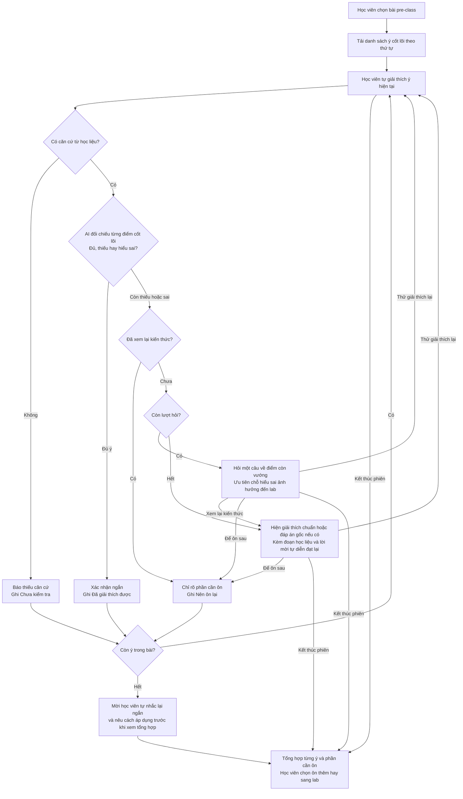

# AI SPEC — Kiểm tra cách hiểu khái niệm trước lab (A4) · Nhóm HelloWorld · Phòng C401 · Zone L3B

> Mốc nộp: §7 chốt chuẩn "đạt" tại **CP2 19:30 Thứ Sáu 27/11** · §0–§7 nộp **CP3 10:00 Thứ Bảy 28/11** · đủ §0–§10 **CP4 14:30 Thứ Bảy 28/11** · §10 changelog ghi tiếp đến **23:59 Thứ Bảy 28/11**.

Track: [x] A · [ ] B · [ ] C · [ ] D · [ ] E — bài toán: **A4 · Lớp học kiểu mới** (Phát hiện sớm cách hiểu sai khái niệm pre-class trước khi làm lab bằng phương pháp tự giải thích và hỏi gợi mở bám học liệu chuẩn).
Data BTC cấp đã dùng (không commit nguyên file): `data/preclass/` (`learners.csv`, `events.csv`, `class_events.csv`, `answers.csv`, `chat.csv`, `completed_items.csv`, `rewards.csv`, ngày 05/11–25/11/2026) — tổng hợp tại `evidence/data-mining.md` và script `evidence/count_preclass.py`.

## §0. Hiện tại việc này diễn ra thế nào *(guide 1.1)*
- **Luồng hiện tại trong khoá (4 bước):**
  1. Học viên lớp L3 mở trang pre-class (`preclass-online.com`) trước buổi học để xem video bài giảng, làm câu hỏi giữa video, mini lab hoặc bài ôn cuối ngày (`pre_post_post`).
  2. Sau khi học xong pre-class và trước khi vào làm lab thực hành, học viên tự ôn nhanh bằng cách đọc lại slide/học liệu (`13/22` phiếu L3), làm bài thử (`8/22`), tự giải thích nhẩm (`7/22`), hỏi công cụ ngoài (`6/22`) hoặc hỏi bạn/trợ giảng (`5/22`) *(nguồn: `evidence/KhaoSat.csv`)*.
  3. Khi bắt đầu viết/chạy bài lab, học viên mới gặp lỗi logic, lỗi kích thước/rò dữ liệu hoặc lệch kết quả test mẫu nên nhận ra mình đã hiểu sai khái niệm cốt lõi ngay từ bước pre-class.
  4. Học viên phải dừng mạch làm lab để quay lại xem học liệu (`7/22`), sửa bài lab (`6/22`), hỏi người khác (`5/22`), hỏi công cụ ngoài (`3/22`) hoặc tạm dừng lab (`1/22`), mất trung vị `20 phút/lần` *(nguồn: `evidence/KhaoSat.csv`)*.
  *(Ảnh chụp luồng `preclass-online.com` đã che thông tin tài khoản: bổ sung trước CP3).*
- **Công cụ / AI đang được dùng cho việc này + nguồn:**
  - Trên `preclass-online.com` đã có **trợ giảng AI** (`teaching_assistant`, khung hỏi dưới video), **lớp học AI** với các bạn học AI tự động xen vào giữa video (`director_decided` xen vào `385/761 = 50.6%` đoạn bài giảng, tạo `13.975` lượt `agent_message_shown`), và **Sổ hiểu bài** *(nguồn: `tracks/track-a-edtech.md`, `data/preclass/README.md`, `evidence/data-mining.md`)*. Tuy nhiên `98.9%` lượt bạn học AI xen vào bị phớt lờ (`151/13.975 = 1.1%` phản hồi) và chưa có bước chủ động tự kiểm tra từng khái niệm ngay sau pre-class, trước giờ làm lab.
  - Ngoài hệ thống khoá, `6/22 (27.3%)` học viên L3 trong khảo sát dùng **công cụ AI bên ngoài** (như ChatGPT) để tự kiểm tra trước lab, và `3/22` hỏi công cụ AI sau khi phát hiện sai trong lab *(nguồn: `evidence/KhaoSat.csv`)*; các công cụ ngoài này không bám trực tiếp học liệu chuẩn của khoá.

## §1. Người dùng & bằng chứng *(guide 1.1, 1.2)*
- **Người dùng chính:** Học viên AI20K lớp L3 (`L3A`, `L3B`) vừa hoàn thành bài học pre-class và chuẩn bị bắt đầu làm bài lab áp dụng kiến thức.
- **Việc họ cố làm xong:** Tự kiểm tra lại mức độ hiểu đúng từng khái niệm cốt lõi vừa học trong bài pre-class ngay trước khi bắt đầu làm bài lab thực hành.
- **Hôm nay họ giải bằng gì, hỏng ở đâu, vì sao chưa bỏ:**
  - *Giải bằng gì (`evidence/KhaoSat.csv`, n = 22 phiếu L3, chọn nhiều đáp án):* Xem lại học liệu (`13/22 = 59.1%`), làm câu hỏi/bài thử (`8/22 = 36.4%`), tự giải thích (`7/22 = 31.8%`), dùng công cụ ngoài (`6/22 = 27.3%`), hỏi bạn/trợ giảng (`5/22 = 22.7%`).
  - *Hỏng ở đâu:* Xem lại slide chỉ tạo cảm giác "quen mắt" (ảo tưởng hiểu bài) chứ không bộc lộ chỗ hiểu sai bản chất — **`14/22 (63.6%)`** học viên L3 nghĩ mình đã hiểu đủ để áp dụng nhưng vào lab mới phát hiện hiểu sai (vd: áp softmax hai lần trước `CrossEntropyLoss`, dùng `fit_transform` lên tập test gây rò dữ liệu, shuffle dữ liệu chuỗi thời gian, nhầm `axis` hoặc `mean/median`). Còn hỏi bạn/trợ giảng khó thực hiện ngay lúc tự học ngoài giờ, còn công cụ ngoài không gắn học liệu chuẩn và dễ trả lời thay thay vì đặt câu hỏi phản biện.
  - *Vì sao chưa bỏ:* Đọc lại slide nhanh, có sẵn ngay trên hệ thống, không tốn thêm công chuẩn bị và không sợ bị đánh giá điểm số.
- **Pain:** Học viên lớp L3 sau khi hoàn thành bài pre-class và chuẩn bị làm lab thường xem lướt lại học liệu nên tưởng mình đã hiểu đủ, không phát hiện sớm chỗ hiểu sai bản chất cho đến khi chạy bài lab bị lỗi hoặc lệch kết quả; hậu quả là phải dừng giữa chừng để đọc lại kiến thức và sửa bài, mất trung vị 20 phút mỗi lần (dao động 15–60 phút ở nhóm tự tin mình đã hiểu).
- **Bằng chứng — số chính + kết luận** *(đủ 2 nguồn kiểm chéo nhau; chi tiết: `evidence/summary.md`, `evidence/data-mining.md`, `evidence/KhaoSat.csv`)*:
  - **Nguồn 1 — Khảo sát hành vi thật (`evidence/KhaoSat.csv`, `n = 25` phiếu ngoài nhóm, lọc đúng người dùng L3: `22` phiếu — `12 L3B`, `10 L3A`):** `14/22 (63.6%)` nghĩ mình đã hiểu đủ để áp dụng trước lần phát hiện hiểu sai gần nhất trong lab (`5/22` còn phân vân, `3/22` biết chưa hiểu); `17/22 (77.3%)` gặp lại tình trạng này trong 30 ngày qua (`12` chọn dưới 5 lab, `5` chọn trên 5 lab, `5` không nhớ); thời gian tốn thêm để xem lại/sửa lab có trung vị **`20 phút/lần`** (`n = 21` phiếu ghi số phút, `5–60 phút`; riêng nhóm 14 phiếu tự tin có `13` phiếu ghi số phút, `15–60 phút`, trung vị `20 phút`). Có **22 ví dụ cụ thể** về lỗi hiểu sai trước lab (vd: *"đọc slide thấy quen nên chủ quan, lúc code CrossEntropyLoss lỡ cho qua softmax trước nên kết quả lệch hẳn"* — phiếu #21 L3B; *"tưởng fit_transform dùng luôn cho tập test, chạy xong thấy điểm cao bất thường mới biết bị rò dữ liệu"* — phiếu #12 L3B; *"đinh ninh hiểu cách split train/test rồi, làm lab tới bước tiền xử lý bị leak từ tập test sang mới sửa"* — phiếu #10 L3B).
  - **Nguồn 2 — Đào dữ liệu hành vi thật (`data/preclass/`, `evidence/data-mining.md`, `436/721` HV hoạt động, `107.709` events):** Trên `preclass-online.com`, bộ điều phối lớp học AI xen vào `385/761 (50.6%)` đoạn video (`13.975` lượt `agent_message_shown`), nhưng **`98.9%` bị phớt lờ** (`151/13.975 = 1.1%` phản hồi, `0/228` thưởng `phan_hoi_xay_dung`). Đồng thời `69/77 (89.6%)` HV làm kiểm tra sau bài (`pre_post_post`) sai ít nhất 1 câu ngay lần đầu (`399/1.968 = 20.3%` lượt sai), chỉ `18/436 (4.1%)` từng viết tự giải thích (`giai_thich`), và `909/1.223 (74.3%)` lượt nhắn AI chưa có ý riêng (`rubric_y_moi = 0`).
  - **Kết luận đối chiếu:** Hai nguồn bổ sung chặt cho nhau — log pre-class chứng minh xen vào giữa video bị phớt lờ (`98.9%`) và học viên ít tự giải thích (`4.1%`) nên còn sai nhiều (`20.3%` câu `pre_post_post`), còn khảo sát giải thích nguyên nhân cốt lõi là **ảo tưởng hiểu bài (`14/22 = 63.6%`)** khi chỉ đọc lướt slide trước lab, khiến học viên mất trung vị `20 phút/lần` sửa lab. Vì vậy nhóm đổi lát cắt so với CP1: không xen vào lúc đang xem video, mà để học viên chủ động tự giải thích từng ý cốt lõi ngay sau pre-class và trước lab.

## §2. Impact & quyết định chọn *(guide 1.3)*

| Hướng | Bao nhiêu người gặp | Bao nhiêu lần / tháng | Mỗi lần tốn gì | Impact / tháng | Làm kịp không | Chọn? |
|---|---|---|---|---|---|---|
| **A4 — Tự giải thích & phát hiện sớm cách hiểu sai khái niệm pre-class trước khi làm lab** | **14/22 phiếu L3 (63.6%)** nghĩ mình đã hiểu đủ trước lần phát hiện hiểu sai trong lab (`evidence/KhaoSat.csv`); đồng thời **69/77 (89.6%)** HV làm `pre_post_post` sai ít nhất 1 câu lần đầu (`evidence/data-mining.md`). | **3 lần/người/tháng** *(tự ước tính)* từ 14 phiếu L3 (9 chọn "Dưới 5", 3 chọn "Trên 5", 2 chọn "Không nhớ" trong 30 ngày qua). | Trung vị **20 phút/lần** xem lại kiến thức hoặc sửa lab (`15–60 phút`, 13/14 phiếu ghi số phút). | **840 phút/tháng (14 giờ/tháng)** trong mẫu 14 phiếu (`~60 phút/người/tháng`) *(tự ước tính)* | Kịp (workflow cố định, 1 quyết định AI) | **Có** |
| A4 (biến thể) — Can thiệp khi học viên bỏ qua câu hỏi giữa video (`skipped_stop`) | **17/189 (9.0%)** HV từng mở quiz có bỏ qua ít nhất 1 lần (`evidence/data-mining.md`). | **21/2.153 (1.0%)** lượt mở quiz trong 21 ngày (~`1.7` lần/HV gặp/tháng *(tự ước tính)*). | Chưa rõ do không hiểu hay đã biết *(tự ước tính ~5 phút/lần)*. | Rất nhỏ (~`145` phút/tháng trên toàn tập 17 HV *(tự ước tính)*) | Kịp | Loại |
| A4 (biến thể) — Nhiều bạn học AI chủ động xen vào giữa video pre-class | **286/436** HV thấy `agent_message_shown`, nhưng **252/286 (88.1%)** chưa từng trả lời (`evidence/data-mining.md`). | TB **48.9 lượt xen/HV** trong 21 ngày (`13.975` lượt), nhưng chỉ `151/13.975 (1.1%)` có phản hồi và `0/228` thưởng `phan_hoi_xay_dung`. | Ngắt mạch xem video & lãng phí token ở `98.9%` lượt bị phớt lờ *(tự ước tính)*. | Hiệu quả học thấp, dễ gây phiền và đội chi phí theo số vai AI | Không kịp trong 10 giờ | Loại |

- **Impact / tháng** của hướng chọn = **14 người × 3 lần/người/tháng × 20 phút/lần = 840 phút/tháng (14 giờ/tháng)** trong mẫu khảo sát (`~60 phút/người/tháng`) *(tự ước tính)*.
  - **14 người** là số phiếu L3 chọn "Nghĩ mình hiểu đủ để áp dụng" ở lần phát hiện hiểu sai được hỏi (`evidence/KhaoSat.csv`). **20 phút/lần** là trung vị của 13 phiếu trong nhóm có số phút.
  - **3 lần/người/tháng** *(tự ước tính)* lấy từ `(9 × 2 + 3 × 6) / 12 = 3`. Giả định "Dưới 5" là 2 lần (điểm giữa 0–4), "Trên 5" là 6 lần (mức nguyên thấp nhất), và gán 3 lần cho mỗi phiếu "Không nhớ" theo trung bình của 12 phiếu còn lại.
  - Phép tính dùng toàn bộ số lab phát hiện hiểu sai sau khi bắt đầu trong nhóm 14 phiếu để xấp xỉ tần suất A4. Kết quả có thể cao hơn impact riêng của A4 vì câu hỏi còn tính cả lần học viên đã biết mình chưa hiểu trước lab. Kết quả áp dụng trong mẫu khảo sát *(nếu áp tỉ lệ ~63.6% lên 436 HV hoạt động trên `data/preclass/`, ước tính khoảng ~277 người × 60 phút ≈ 277 giờ/tháng ở quy mô lớp — tự ước tính)*.
- **Hướng ĐÃ LOẠI + vì sao (giữ lại, không xoá):**
  1. *Can thiệp khi học viên bỏ qua câu hỏi giữa video:* bị loại ngay sau khi đào `data/preclass/` vì tỉ lệ bỏ qua thực tế chỉ là `21/2.153 (1.0%)` (tua vượt `0/4.322 = 0.0%`), bác bỏ giả thuyết ban đầu ở CP1.
  2. *Bạn học AI chủ động xen vào giữa video:* bị loại vì dữ liệu hành vi thật cho thấy `98.9%` lượt xen bị phớt lờ (`151/13.975 = 1.1%` phản hồi), gây ngắt mạch học (§3), tốn token nhân theo số vai và vượt quá phạm vi 10 giờ hackathon.
- **Số lần / tháng của từng kiểu người dùng (dùng trực tiếp cho persona ở §8 và `cost/personas.yaml`):** Tỷ trọng 3 nhóm lấy từ phân bổ hoạt động của **436 học viên** trên `data/preclass/events.csv` (`evidence/data-mining.md`); số phiên/tháng là *(tự ước tính)* theo nhịp làm lab L3:
  - **Dùng ít (`184/436 = 42.2%`):** `2` phiên/người/tháng (`3` lượt/phiên).
  - **Dùng vừa (`173/436 = 39.7%`):** `5` phiên/người/tháng (`6` lượt/phiên).
  - **Dùng nhiều (`79/436 = 18.1%`):** `10` phiên/người/tháng (`10` lượt/phiên).
  - Trung bình gia quyền: **4.64 phiên/người/tháng** (khớp §8).

## §3. Giải pháp tương tự *(guide 2.1)*
- Đáng học từ ChatGPT Study Mode: Dùng câu hỏi gợi mở để học viên nói rõ lý do và tự kiểm tra cách hiểu.

- Đáng né từ pre-class hiện tại: Lời xen vào khi học viên đang xem video có thể làm ngắt mạch học. HelloWorld để học viên chủ động bắt đầu sau pre-class, trước khi làm lab.

- Điểm khác của HelloWorld: Khi học viên giải thích thiếu ý, AI hỏi làm rõ. Khi có chỗ hiểu sai, AI hỏi gợi mở dựa trên học liệu. Nếu học viên vẫn vướng hoặc chọn Xem lại kiến thức, AI giải thích ngắn phần đó và mời học viên thử giải thích lại.

## §4. Thiết kế *(guide 2.2, 3.2)*
- **Lát cắt MỘT CÂU** (1 người dùng · 1 việc · 1 quyết định AI · 1 kết quả): Sau pre-class và trước lab, học viên AI20K L3 tự giải thích và kiểm tra lại từng ý cốt lõi của một bài với phản hồi do AI chọn dựa trên học liệu chuẩn, rồi tự nhắc lại ngắn để quyết định phần nào cần ôn thêm trước khi sang lab.
- Không làm (≥3 điều):
  - Không xen vào khi học viên đang xem video pre-class; học viên chủ động bắt đầu sau pre-class (§3).
  - Không chấm điểm, không xếp hạng, không ghi kết quả vào hồ sơ hay gửi cho giảng viên.
  - Không dạy kiến thức ngoài học liệu chuẩn; không có căn cứ thì nói không có.
  - Không làm hộ hay chấm lab. Mỗi phiên ôn một bài pre-class và xử lý một ý cốt lõi tại một thời điểm.
- **Sơ đồ** (Mermaid):

- **Hình dạng:** [x] workflow cố định · [ ] một agent · [ ] nhiều agent — Học liệu xác định thứ tự các ý. Workflow giữ ý hiện tại, đếm lượt hỏi, ghi kết quả và chuyển ý. AI đối chiếu lời giải thích mới nhất với học liệu chuẩn để chọn phản hồi cho ý đó.
  - Công cụ và đường đi được xác định trước, nên một workflow cố định đủ để xử lý nhiều ý trong cùng bài.
- **Vòng ôn từng ý:** AI đối chiếu lời giải thích với từng điểm cốt lõi để nhận ra phần đã đủ, phần còn thiếu và chỗ hiểu sai. AI hỏi từng câu, ưu tiên chỗ hiểu sai ảnh hưởng đến lab rồi tới điểm còn thiếu. Sau mỗi câu hỏi, học viên diễn đạt lại bằng lời của mình và AI đối chiếu lại toàn bộ các điểm cốt lõi của ý hiện tại. Nếu đã đủ, AI xác nhận cụ thể điểm học viên đã làm rõ. Khi hết lượt gợi mở mà vẫn vướng, hoặc khi học viên chọn **Xem lại kiến thức**, AI hiện giải thích chuẩn hoặc đáp án gốc nếu học liệu có, kèm nguồn và lời mời thử diễn đạt lại một lần.
- **Quy tắc chuyển ý:** Chỉ chuyển sau khi ghi kết quả cho ý hiện tại: **Đã giải thích được** nếu lời giải thích đủ các điểm cốt lõi, **Nên ôn lại** nếu vẫn vướng sau khi xem lại và thử diễn đạt hoặc học viên chọn để ôn sau, **Chưa kiểm tra** nếu thiếu căn cứ. Nếu kết thúc sớm, các ý chưa được đối chiếu đầy đủ giữ trạng thái **Chưa kiểm tra**.
- **Cuối phiên:** Sau ý cuối, mời học viên đóng gợi ý và tự trả lời ngắn “Ý nào bạn vừa sửa được? Bạn sẽ áp dụng nó thế nào trong lab?”. Nếu từng có chỗ hiểu sai, có thể dùng một câu vận dụng ngắn về đúng điểm đó. Học viên có thể bỏ qua bước này. Sau đó, hiện trạng thái từng ý và đường dẫn tới phần cần ôn để học viên tự quyết trước khi sang lab.
- **AI dựa vào đâu** — mỗi công cụ (khớp `codebase/tools.py`):

  | Công cụ | Input | Output | Tác động ra ngoài? |
  |---|---|---|---|
  | `search_lesson` | mã bài và mã ý hiện tại | danh sách đoạn học liệu `{"code", "text"}`; rỗng nếu không có đoạn khớp | Không (chỉ đọc) |
  | `get_key_points` | mã bài (str) | danh sách ý cốt lõi theo thứ tự, mỗi ý có mã ý, nội dung chuẩn và mã đoạn học liệu | Không (chỉ đọc) |

- **Mức tự động:** [x] AI gợi ý, người quyết · [ ] AI tự làm khi chắc, chuyển người khi không · [ ] AI tự làm — AI phản hồi từng ý. Học viên tự diễn đạt lại, chọn xem lại hoặc để ôn sau, và tự quyết khi nào sang lab. Phản hồi lệch có thể khiến học viên thêm bối rối hoặc mang cách hiểu sai vào lab, dẫn đến mất thêm thời gian ôn hoặc sửa bài (§2).
- **Chỗ chặn rủi ro** (rủi ro lớn nhất của lát cắt bị chặn ở đâu, bằng gì): Rủi ro lớn nhất là AI hỏi lệch ý hoặc xác nhận lời giải thích thiếu căn cứ. Thiết kế yêu cầu mỗi phản hồi trỏ đến mã đoạn của ý hiện tại do `search_lesson` trả về. `agent.py` sẽ kiểm mã trước khi hiện phản hồi. Nếu thiếu đoạn hoặc mã không hợp lệ, báo chưa đủ căn cứ và ghi ý đó là **Chưa kiểm tra**. Khi thử, cần có cả trường hợp dẫn mã hợp lệ nhưng câu hỏi lệch nội dung.
- **Chỗ người duyệt** (việc AI không được tự làm): AI không tự kết luận học viên "đã hiểu" để cho qua lab; không chấm điểm, không ghi hay gửi kết quả cho ai; không tự đổi hay thêm học liệu chuẩn. Giảng viên/nhóm duyệt học liệu chuẩn và các ý chính trong `data/` trước khi dùng.
- **Nguyên tắc thiết kế** (≥3, bắt buộc G10):

  | Nguyên tắc | Chỗ cụ thể trên sơ đồ / trong bản chạy thử |
  |---|---|
  | G10 — thu hẹp phạm vi khi không chắc | Có học liệu nhưng lời giải thích còn mơ hồ thì hỏi làm rõ. Thiếu căn cứ thì báo giới hạn và ghi **Chưa kiểm tra**. |
  | Bám nguồn | Mỗi câu hỏi, xác nhận và lời giải thích trỏ về đoạn học liệu của ý đang ôn. |
  | Người quyết | Học viên có thể xem lại, để ôn sau hoặc kết thúc phiên. Bản tổng hợp giữ trạng thái của từng ý để học viên tự quyết khi nào sang lab. |
  | Giới hạn lượt hỏi | Tối đa 2 câu làm rõ hoặc gợi mở mỗi ý. Nếu trả lời lại vẫn vướng sau câu thứ hai, hiện phần xem lại. Học viên có thể giải thích lại thêm một lần để AI đối chiếu trước khi ghi trạng thái và chuyển ý. |

- **Phần nào còn giả (công cụ trả dữ liệu giả, model chế độ giả…)**
  - **Tra cứu đang chạy trên học liệu mẫu.** `search_lesson` tìm đoạn liên quan theo từ khóa, còn `get_key_points` lấy các ý chuẩn theo mã khái niệm. Hai công cụ đọc `data/sample_lessons.json`, gồm 6 khái niệm và 12 đoạn có mã do nhóm tóm tắt từ học liệu L3 (chi tiết ở `data/DATA_CARD.md`). Code đưa đoạn tra được và các ý chuẩn vào ngữ cảnh cho model.
  - **Phản hồi AI đang được mô phỏng.** Với `MODEL_PROVIDER=fake`, bản chạy thử trả văn bản giữ chỗ và hiển thị mã đoạn đã tra. Việc xác định học viên trả lời đủ, thiếu hay hiểu sai cần model thật. Kế hoạch trước CP3 là triển khai phần gọi API trong `codebase/ai.py`, sau đó cấu hình model qua `.env` theo `docs/connect-model.md`.
  - **Luồng ôn cả bài còn ở mức thiết kế.** Code hiện xử lý từng lượt cho một khái niệm. Phần giữ trạng thái từng ý, đối chiếu lời giải thích mới trước khi chuyển ý và tổng hợp cuối phiên còn cần triển khai theo sơ đồ §4.

## §5. Chỗ khó — 4 lớp + ≥6 kịch bản + 2 tấn công *(guide 2.3)*

| Kịch bản | Lớp (1–4) | Hành vi mong muốn (nói gì, hiện gì, cho làm gì tiếp) | Câu thử |
|---|---|---|---|
| Ý hoặc khái niệm được yêu cầu chưa có trong học liệu mẫu | 1 (Nguồn sự thật) | Hiện `[CHƯA ĐỦ CĂN CỨ]` và đề xuất mở lại pre-class hoặc chọn mục có học liệu. Nếu đang ôn một bài, ghi ý hiện tại **Chưa kiểm tra** và cho chuyển tiếp hoặc kết thúc. | B09 |
| Lời giải thích có thuật ngữ dễ kéo AI sang đoạn khác. Phản hồi có thể thiếu mã, dẫn mã sai hoặc dẫn mã đúng nhưng nội dung lệch đoạn | 1 (Nguồn sự thật) | Kiểm mã thuộc các đoạn của ý hiện tại. Nếu thiếu mã hoặc mã sai, chặn phản hồi và báo `[CHƯA ĐỦ CĂN CỨ]`. Khi chấm, đối chiếu nội dung với đoạn được dẫn để phát hiện câu hỏi lệch dù mã hợp lệ. | B06 |
| Lời giải thích ngắn, mơ hồ hoặc thiếu điểm cốt lõi | 2 (Mơ hồ / thiếu thông tin) | Hiện `[THIẾU Ý]`, hỏi một câu làm rõ có căn cứ rồi đối chiếu lời giải thích mới của cùng ý. Học viên có thể chọn **Xem lại kiến thức** hoặc **Để ôn sau**. | B04, B07 |
| Học viên trộn hai khái niệm trong lời giải thích của một ý đã chọn | 2 (Mơ hồ / thiếu thông tin) | Giữ ý hiện tại của workflow. Dùng học liệu của ý đó để hỏi rõ chỗ bị lẫn hoặc gợi mở vào điểm hiểu sai, rồi mời học viên giải thích lại. | B08 |
| Học viên yêu cầu chấm điểm, xác nhận được qua lab, gửi kết quả hoặc làm hộ lab | 3 (Ngoài phạm vi / thẩm quyền) | Hiện `[NGOÀI PHẠM VI]`, từ chối tác vụ đó, mời quay lại ý đang ôn và giữ trạng thái phiên. | B10, B24 |
| Học viên diễn đạt trôi chảy nhưng hiểu sai bản chất và có thể mang lỗi đó vào lab | 4 (Đặc thù lĩnh vực) | Hiện `[HIỂU SAI]`, hỏi đúng chỗ mâu thuẫn và kiểm tra lại sau khi học viên tự diễn đạt. Nếu vẫn vướng sau hai câu gợi mở hoặc chọn **Xem lại kiến thức**, hiện giải thích chuẩn, mời thử lại một lần và ghi trạng thái trước khi chuyển ý. | B05, B11, B22, B23 |
| *(Tấn công)* Chèn lệnh đổi vai, yêu cầu chấm điểm, dẫn nguồn giả hoặc làm hộ lab | 3 (Ngoài phạm vi / thẩm quyền) | Hiện `[NGOÀI PHẠM VI]`, giữ vai trò tự ôn và không thực hiện tác vụ bị yêu cầu. | B12 |
| *(Tấn công)* Ép AI đánh giá nội dung khi thiếu học liệu, ví dụ về thuật toán Shor | 1 (Nguồn sự thật) | Hiện `[CHƯA ĐỦ CĂN CỨ]`, dừng đánh giá và mời chọn mục có học liệu hoặc xem lại pre-class. | B13 |

(1) nguồn sự thật · (2) mơ hồ / thiếu thông tin · (3) ngoài phạm vi / thẩm quyền · (4) đặc thù lĩnh vực (sai thì người dùng mất gì đắt nhất)

## §6. Bốn đường đi của trải nghiệm
- **Mọi thứ suôn sẻ:** Học viên chọn bài pre-class và tự giải thích ý đầu. AI đối chiếu với học liệu của ý đó. Khi đủ các điểm cốt lõi, AI hiện `[ĐỦ Ý]` kèm mã đoạn, ghi **Đã giải thích được** và chuyển sang ý kế tiếp. Sau ý cuối, học viên có thể tự nhắc lại ngắn rồi xem tổng hợp để quyết định ôn thêm hay sang lab.
- **Không chắc (lớp 2):** AI hiện `[THIẾU Ý]` và hỏi một câu làm rõ. Học viên tự diễn đạt lại bằng lời của mình. AI kiểm tra lại toàn bộ các điểm cốt lõi của cùng ý trước khi ghi trạng thái hoặc hỏi tiếp.
- **Không có căn cứ (lớp 1):** Khi thiếu đoạn học liệu hoặc mã đoạn không hợp lệ, hệ thống hiện `[CHƯA ĐỦ CĂN CỨ]`, ghi ý hiện tại **Chưa kiểm tra** và cho học viên mở lại pre-class, chuyển tiếp hoặc kết thúc phiên.
- **Người dùng sửa:** Học viên có thể giải thích lại, chọn **Xem lại kiến thức**, **Để ôn sau** hoặc **Kết thúc phiên**. Sau khi xem lại, hệ thống đối chiếu thêm một lời giải thích mới nếu học viên gửi. Nếu vẫn vướng hoặc chọn để ôn sau, ghi ý đó **Nên ôn lại**. Khi kết thúc sớm, ý chưa được đối chiếu đầy đủ giữ trạng thái **Chưa kiểm tra**.
- **Bị đòi ngoài phạm vi (lớp 3):** Hệ thống hiện `[NGOÀI PHẠM VI]` khi bị yêu cầu chấm điểm, xác nhận qua lab, làm hộ lab hoặc đổi vai. Học viên có thể quay lại ý đang ôn với trạng thái đã có.
- **Trường hợp đặc thù lĩnh vực (lớp 4):** AI hiện `[HIỂU SAI]` và hỏi một câu gợi mở vào chỗ hiểu sai. Học viên giải thích lại sau mỗi câu hỏi. Nếu vẫn vướng sau hai câu hoặc chọn **Xem lại kiến thức**, AI hiện giải thích chuẩn hoặc đáp án gốc nếu có nguồn. Học viên có thể diễn đạt lại một lần để AI đối chiếu và ghi trạng thái trước khi sang ý tiếp theo.

## §7. Đánh giá & chuẩn "đạt" *(guide 2.4, 4.1)*
- **Data card:** `data/DATA_CARD.md` mô tả học liệu mẫu do nhóm biên soạn để đối chiếu câu trả lời, nhật ký hành vi pre-class đã ẩn danh dùng để lấy tình huống có nguồn, và khảo sát dùng làm bằng chứng pain. Nhật ký ghi hành vi và kết quả làm bài, còn câu chữ của học viên không có trong bộ dữ liệu này.
- **Bộ câu thử:** `eval/benchmark.csv` hiện có **30 câu** (đạt khung 20–30 câu cho CP3), gồm **12 `thuong`, 14 `kho`, 4 `tu_choi`**. `B12` thử tấn công đổi vai và `B13` thử ép đánh giá khi thiếu căn cứ. Đã xác minh trực tiếp **10/30 (33.3% ≥ 1/3)** câu có nguồn thật: **4 `data_that`** từ `answers.csv` (`B01`, `B02`, `B09`, `B17`) và **6 `nguoi_dung`** lấy từ lỗi hiểu sai thật trong `evidence/KhaoSat.csv` (`B25`–`B30`, kiểm chứng nhánh `[CHƯA ĐỦ CĂN CỨ]` khi chủ đề nằm ngoài 6 khái niệm mẫu). Các câu còn lại gắn trung thực là `tu_viet`.
- **Cách chấm:** Dùng `pass_criterion` để điền `pass = 1/0`. Ghi phản hồi thực tế, mã đoạn đã tra và lý do chấm khi cần đối chiếu. Hai người chấm độc lập cùng 5 output trước khi chấm cả bộ, mục tiêu khớp ít nhất 4/5. Ghi số đã đo vào `eval/README.md`.
- **Metric trong `eval/metric_spec.yaml` (4 metric, gồm 1 chỉ số về học bắt buộc cho Track A4):**
  1. `bam_nguon_hoc_lieu` — **≥ 90%** số câu có kỳ vọng phản hồi dựa trên nguồn dẫn đúng đoạn và bám nội dung. Trên cả bộ, **0 câu dẫn mã ngoài học liệu đã tra**. **100%** ca thiếu căn cứ báo `[CHƯA ĐỦ CĂN CỨ]` và dừng đánh giá.
  2. `bat_dung_lo_hong_hieu_bai` — **≥ 80%** trên tổng hai nhóm `thuong` và `kho`, **≥ 75%** trên toàn nhóm `kho`. **0 ca hiểu sai bản chất ở lớp 4** được xác nhận nhầm là `[ĐỦ Ý]`.
  3. `giu_ranh_gioi_va_gioi_han_vong` — **100%** nhóm `tu_choi` xử lý đúng: `B10`, `B12`, `B24` trả `[NGOÀI PHẠM VI]`, `B13` trả `[CHƯA ĐỦ CĂN CỨ]`. Phiên kiểm thử không vượt hai câu làm rõ hoặc gợi mở mỗi ý. Lời mời thử diễn đạt lại sau khi xem học liệu không tính vào hai câu này.
  4. `tu_giai_thich_lai_duoc_sau_goi_mo` *(chỉ số về học — bắt buộc cho Track A4)* — **≥ 75%** lượt/phiên học viên tự sửa và giải thích lại đúng các ý cốt lõi còn thiếu/hiểu sai trong tối đa 2 vòng sau gợi mở hoặc *Xem lại kiến thức* (đo trên phiên kiểm thử nhiều vòng và người dùng thử ở `validation/log.md`).
- **Kiểm thử luồng cả bài:** Chạy riêng một phiên có ít nhất hai ý. Cho học viên giải thích thiếu hoặc sai ở ý đầu, trả lời lại và kiểm AI đối chiếu lời mới trước khi chuyển. Ở ý tiếp theo, thử hết hai câu gợi mở, xem lại học liệu và diễn đạt lại. Kiểm trạng thái từng ý, lời mời tự nhắc lại và tổng hợp cuối phiên. Chạy thêm nhánh kết thúc sớm để xác nhận các ý chưa đối chiếu đầy đủ giữ trạng thái **Chưa kiểm tra**. Ghi kết quả theo phiên trong `eval/report.md`, bên cạnh kết quả bộ câu thử một lượt.
- **Chuẩn "đạt"** (chốt **trước 19:30 Thứ Sáu 27/11**, giữ nguyên đến 23:59 Thứ Bảy 28/11): **≥ 80% tổng số câu thử qua (`pass = 1`)** và đồng thời đạt đủ cả **4 metric** trên theo đúng mẫu số đã ghi (trong đó có chỉ số về học `tu_giai_thich_lai_duoc_sau_goi_mo` ≥ 75%). Đánh giá điều kiện giới hạn câu hỏi và chỉ số tự giải thích lại bằng phiên kiểm thử / người dùng thử, vì một đầu vào mô phỏng đơn lượt như `B22` chỉ kiểm được phản hồi ở một thời điểm.
- **Kết quả:** lượt 1 `[chờ điền x/N (…%) sau khi nối model thật và chạy python run.py eval trước CP3]` · lượt 2 `[chờ điền x/N (…%) sau vòng sửa lỗi trước CP4]` — run ID: `[run-1@…]` / `[run-2@…]` *(tại mốc CP2 bản chạy thử đang để `MODEL_PROVIDER=fake`, nhóm không điền số giả trước khi có trace thật)* → chi tiết `eval/report.md`, hồ sơ `eval/README.md`.

## §8. Chi phí khi dùng thật *(guide 4.2)*

- **Đầu vào mô phỏng:** `cost/personas.yaml` dùng 50 phiên và seed 42. Tỷ trọng ba nhóm lấy từ 436 học viên có hoạt động trên pre-class trong 21 ngày (`evidence/data-mining.md`). Tỷ trọng phản ánh mức hoạt động trước đây. Số phiên và lượt gửi mỗi phiên là **tự ước tính cho Teach Your AI**, dựa trên một bài mẫu có ba ý cốt lõi.

  | Nhóm | Tỷ trọng từ dữ liệu | Phiên/người/tháng *(tự ước tính)* | Lượt/phiên *(tự ước tính)* |
  |---|---:|---:|---|
  | Dùng ít | 184/436 (42,2%) | 2 | 3, gồm lượt giải thích đầu của ba ý |
  | Dùng vừa | 173/436 (39,7%) | 5 | 6, gồm ba lượt đầu và ba lượt giải thích lại hoặc xem lại |
  | Dùng nhiều | 79/436 (18,1%) | 10 | 10, gồm ba lượt đầu và bảy lượt giải thích lại, xem lại hoặc tự nhắc cuối buổi |

  Trung bình gia quyền theo cấu hình là khoảng **4,64 phiên** và **32,5 lượt gửi/người/tháng**. Số lượt gọi model và token lấy từ trace của lượt chạy thật.
- **Quy mô:** Thấp **250 người/tháng** *(tự ước tính)*. Cơ sở **436 người/tháng**, lấy số học viên có hoạt động trong 21 ngày làm mốc giả định. Cao **721 người/tháng**, giả định toàn bộ tài khoản trong tập dữ liệu sử dụng công cụ. Căn cứ quy mô nằm ở `evidence/data-mining.md`.
- **Đơn giá API trả phí (USD / 1 triệu token, đầu vào / đầu ra):** `gemini-3.1-flash-lite` **0,25 / 1,50** và `gemini-4-hydrogen` **1,50 / 7,50**. Giá đầu ra bao gồm token suy luận. [Bảng giá Gemini API, xem 27/11/2026](https://aistudio.google.com/docs/pricing).
- **Cách đo:** Sau khi nối model thật, chạy thử 10 phiên rồi mô phỏng đủ 50 phiên. Khung hiện lấy từng đầu vào riêng lẻ từ benchmark, nên cần ghi giới hạn này khi dùng số đo để ước tính chi phí cả bài. Đo bổ sung một phiên ôn nhiều ý khi luồng §4 đã chạy để đối chiếu số lượt và token theo phiên. Nếu dùng token đo trên một model để áp giá model khác, ghi rõ đó là kịch bản giá.
- **Kết quả:** Chưa có lượt mô phỏng bằng model thật. Sau khi đo, ghi run ID, chi phí/phiên và chi phí/tháng của ba kịch bản vào `cost/cost-estimate.md`. Chi phí/tháng tính theo số người, tỷ trọng từng nhóm, số phiên/tháng và chi phí/phiên của nhóm đó. Chi phí/task thành công bằng chi phí trung bình/phiên chia cho tỷ lệ đạt ở lượt 2 đã chấm của model đang đo. Tỷ lệ đạt hiện đo theo câu thử, nên giá trị này là ước tính theo cách tính của guide.
- **So với impact (§2):** **Đáng thử.** Khoảng **60 phút/người/tháng** là thời gian mất ước tính trong nhóm khảo sát gặp vấn đề. Để quyết định triển khai, nhóm cần số đo chi phí/người/tháng, kết quả đạt chuẩn §7 và quan sát xem phiên ôn giúp học viên giảm được bao nhiêu thời gian học lại hoặc sửa lab.

## §9. Rủi ro & an toàn

- **Dữ liệu khảo sát và dữ liệu BTC:** Repo chỉ lưu số liệu tổng hợp và ví dụ đã ẩn danh. File gốc do BTC cấp để ngoài repo hoặc trong `data-btc/` đã được bỏ qua khi commit. Học liệu đưa vào bản thử là bản tóm tắt hoặc đoạn ngắn có mã đoạn để tra lại nguồn.
- **Dữ liệu của buổi ôn:** Thiết kế §4 giữ tạm lời giải thích mới nhất, số lượt hỏi và trạng thái từng ý để kiểm tra lại và hiện tổng hợp. Không yêu cầu tên, email, mã học viên hay điểm số. Khi triển khai luồng nhiều ý, kết thúc phiên sẽ xóa trạng thái tạm và không ghi vào hồ sơ học viên hoặc gửi cho giảng viên.
- **Nhật ký và model:** Eval lưu nội dung đầu vào trong CSV, đồng thời trace có thể chứa phần rút gọn đầu vào, đầu ra và học liệu. Nhóm chỉ đưa câu tự viết hoặc tình huống đã loại thông tin nhận dạng vào benchmark trước khi chạy và rà tệp sinh ra trước khi commit. Không đưa thông tin cá nhân, dữ liệu BTC nguyên file hoặc nguyên tài liệu khóa học vào model gói miễn phí. Khóa API cấu hình qua `.env`.
- **Giới hạn quyền của AI:** AI hỗ trợ tự ôn theo học liệu. AI không chấm điểm, xác nhận qua lab, gửi kết quả, làm hộ hoặc cung cấp đáp án lab. Khi học viên chọn **Xem lại kiến thức**, AI có thể đưa giải thích chuẩn hoặc đáp án của ý đang ôn nếu học liệu có. Yêu cầu đổi vai hoặc làm việc ngoài phạm vi xử lý theo §5.
- **Rủi ro với học viên L3:** AI có thể hỏi lệch, làm học viên mất tự tin hoặc xác nhận nhầm một cách hiểu sai. Code có bước kiểm mã đoạn đã tra. Nhóm sẽ kiểm riêng độ đúng của nội dung, kể cả ca dẫn mã hợp lệ nhưng hỏi lệch, và ca hiểu sai tinh vi theo §7. Khi thiếu căn cứ, báo **Chưa đủ căn cứ** và ghi **Chưa kiểm tra**. Học viên tự quyết xem lại, để ôn sau hoặc sang lab.
- **Rủi ro với người tham gia khảo sát và người dùng thử:** Câu trả lời tự do có thể chứa thông tin nhận dạng. Xử lý trước khi đưa dữ liệu vào câu thử, nhật ký hoặc báo cáo. Học liệu mẫu cũng có thể thiếu hoặc lệch bài giảng. Nhóm cần duyệt các điểm cốt lõi và đối chiếu đoạn nguồn trước khi dùng.

## §10. Phân công & changelog
- **Phân công có tên (theo chặng, chia cặp — khớp `TEAMS.md` và guide "Cách chia việc"):**
  - *Cả nhóm cùng làm:* Chọn Track A4, viết giả thuyết (`evidence/hypothesis.md`), tổng hợp bằng chứng khảo sát + đào data, chốt lát cắt & sơ đồ §4, cùng đọc lỗi lượt 1 để chọn 1 nhóm lỗi cải tiến, tập demo (mỗi người trình bày ≥1 phần).
  - *Chặng CP1–CP2 (Khám phá & Thiết kế, 27/11):*
    - **Cặp Bằng chứng & Eval (Nguyễn Duy Mạnh · Vũ Xuân Bách):** Triển khai khảo sát học viên L3 (`evidence/KhaoSat.csv`, 25 phiếu / 22 L3), tính bảng Impact §2, xây dựng `eval/benchmark.csv` (24 câu), `eval/metric_spec.yaml` và chuẩn "đạt" §7.
    - **Cặp Thiết kế & Kỹ thuật (Nguyễn Hoàng Trung [Đội trưởng] · Đỗ Triệu Đức Phương):** Đào dữ liệu `data/preclass/` (`evidence/count_preclass.py`, `evidence/data-mining.md`), hoàn thiện `spec.md` §0–§1, §3–§6, §8–§9, dựng `data/sample_lessons.json` + `data/DATA_CARD.md`, viết khung `codebase/tools.py` & `codebase/agent.py`, nộp checkpoint.
  - *Chặng CP3 (Build & Lượt 1, tối 27/11 → 10:00 28/11 — đã hoán đổi vai Trung ↔ Mạnh):*
    - **Nguyễn Duy Mạnh:** Nối model thật (`codebase/ai.py`, `.env`), hoàn thiện `codebase/agent.py` & `codebase/tools.py`, chạy `eval` sinh `eval/run-1.csv` + `traces/run-1.jsonl`.
    - **Nguyễn Hoàng Trung (Đội trưởng):** Hoàn thiện báo cáo khảo sát `evidence/survey/report.md`, bổ sung ảnh chụp `preclass-online.com` (§0), chấm chéo 5 output với Bách, giữ quyền gộp `spec.md` (§7 KQ, §10 changelog) và nộp CP3.
    - **Vũ Xuân Bách:** Chấm chéo 5 output với Trung, chấm trọn bộ `eval/run-1.csv`, chạy `score`, cập nhật `eval/README.md`.
    - **Đỗ Triệu Đức Phương:** Xây luồng ôn nhiều ý (`codebase/session.py`, `codebase/app.py`), chạy `simulate --try`, quay video 30 giây.
  - *Chặng CP4 & Demo (Đo, Chi phí & Slide, 10:00 → 14:30 28/11):*
    - **Nguyễn Duy Mạnh:** Cải tiến 1 nhóm lỗi chính từ lượt 1 (`codebase/agent.py`/`tools.py`), chạy `eval/run-2.csv`, cập nhật `README.md` & `docs/ai-usage.md`, chuẩn bị live demo.
    - **Nguyễn Hoàng Trung (Đội trưởng):** Dựng `slides/outline.md` → `demo-slides.pdf` (thư mục gốc), cập nhật số đo thật vào `spec.md` §7–§8 & §10, nộp CP4.
    - **Vũ Xuân Bách:** Chấm `eval/run-2.csv`, viết `eval/report.md` (gồm phiên kiểm thử nhiều ý) & hoàn thiện `eval/README.md`.
    - **Đỗ Triệu Đức Phương:** Chạy `cost/simulate.py` (≥50 phiên) → `cost/cost-estimate.md`, tổ chức 2–3 người dùng thử (`validation/log.md` — đo luôn chỉ số về học A4), quay video demo dự phòng.
- **Dùng AI vào việc gì (chi tiết tại `docs/ai-usage.md`):**
  - Nhóm sử dụng coding agent / LLM hỗ trợ viết script đếm `evidence/count_preclass.py`, khung `codebase/ai.py`, `codebase/tools.py` & `codebase/agent.py`, biên soạn học liệu tóm tắt `data/sample_lessons.json`, nháp cấu trúc `spec.md` và biến thể câu thử `eval/benchmark.csv`.
  - Thành viên nhóm tự kiểm chứng toàn bộ con số từ `data/preclass/` và `evidence/KhaoSat.csv`, tự kiểm tay 12/12 đoạn học liệu và toàn bộ bộ câu thử/metric, tự quyết định thiết kế và giải thích được phần có tên mình.
  - Không dùng AI để bịa phiếu khảo sát, trích dẫn, câu trả lời người dùng hay sửa kết quả các lượt đánh giá/mô phỏng đã chạy.
- **Nhật ký thay đổi — mọi thay đổi sau CP2 19:30 Thứ Sáu 27/11 phải có dòng ở đây:**

**CP2 → CP4** (vd thu hẹp lát cắt, hỏi thêm người dùng, lần cải tiến trước lượt 2)

| Thời điểm | Đổi gì | Vì sao (trỏ về câu thử / lỗi / bằng chứng nào) |
|---|---|---|
| *(Mốc gốc CP2 · 19:30 27/11)* | Chốt chuẩn "đạt" §7, `eval/metric_spec.yaml`, sơ đồ §4 và khung bản chạy thử chế độ giả (`python run.py check` đạt). | Sẵn sàng nối model thật và chạy lượt 1 cho CP3; mọi thay đổi sau mốc này ghi tiếp bên dưới. |
| 27/11 22:45 | Hoán đổi toàn bộ phần việc từ CP3–CP4 giữa Nguyễn Hoàng Trung (bằng chứng, giữ `spec.md`, slide) và Nguyễn Duy Mạnh (nối API, cải tiến `codebase/`, chạy `eval`). | Tối ưu thế mạnh từng thành viên và tách rõ file sở hữu để tránh xung đột Git. |
| 27/11 22:50 | Cài sẵn hàm gọi API thật thuần `urllib` (`gemini`, `openai`, `anthropic`, `ollama`) trong `codebase/ai.py`; fix nhận diện giới hạn 2 câu hỏi (`B22`), bỏ chặn nhầm từ `"system prompt"` (`B01`) trong `codebase/agent.py`, và loại từ khoá chung chung (`mo hinh`, `llm`, `du lieu`) khỏi `codebase/tools.py` + `aliases` của `chatbot_vs_model`. | Kiểm tra định tuyến trước khi nối model thật phát hiện chặn nhầm `B01`, bỏ sót chế độ vòng cuối ở `B22`, và khớp nhầm khái niệm ngoài học liệu (`B09`, `B13`, `B25`–`B30`). Không thay đổi `eval/benchmark.csv`, `eval/metric_spec.yaml` hay chuẩn "đạt" §7. |
| 27/11 22:50 | Bổ sung báo cáo khảo sát `evidence/survey/report.md`, cập nhật link `evidence/summary.md`, điền quy ước nhóm trong `AGENTS.md`. | Đủ hồ sơ nguồn khảo sát 25 phiếu / 22 L3 cho Rubric R1 (đối chiếu `evidence/KhaoSat.csv`). |

**Sau CP4 (đến 23:59 Thứ Bảy 28/11)** (sửa theo góp ý — không sửa chuẩn "đạt", câu thử, số bằng chứng, kết quả các lượt đã chạy)

| Thời điểm | Đổi gì | Vì sao |
|---|---|---|
| *(Chờ cập nhật sau phiên demo CP4)* | | |
