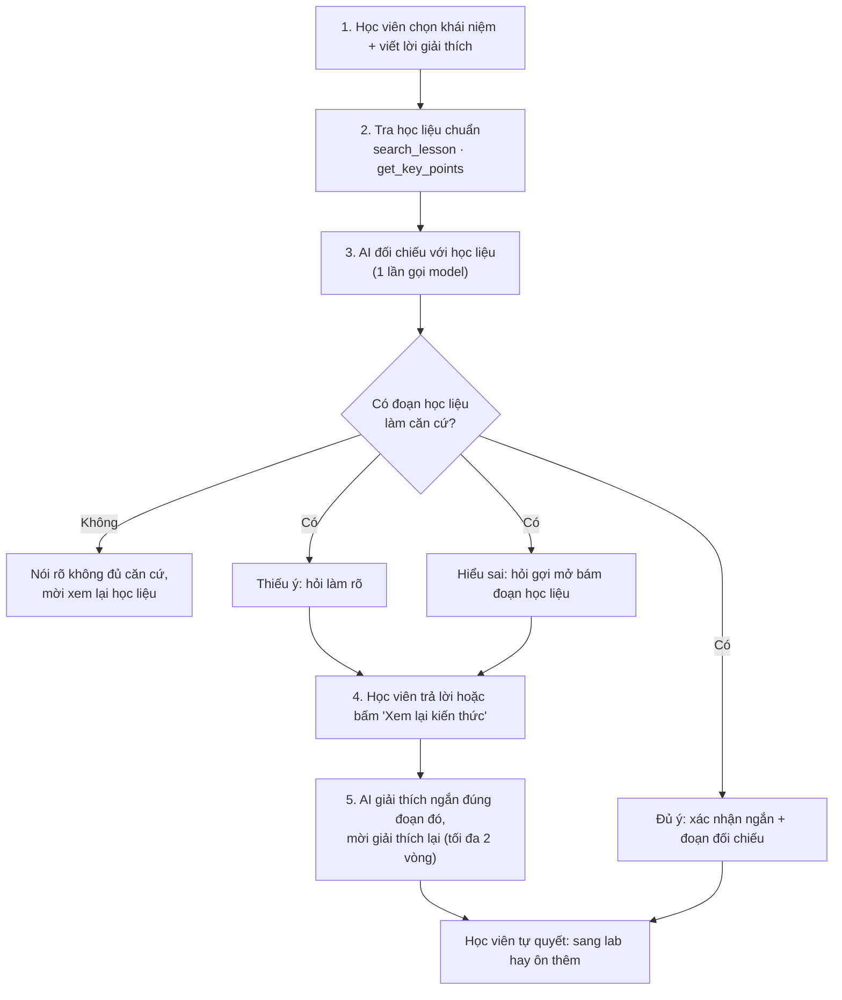

# AI SPEC — [Tên lát cắt] · Nhóm [tên nhóm] · Phòng [XXX] · Zone [X]

> Mốc nộp: §7 chốt chuẩn "đạt" tại **CP2 19:30 Thứ Sáu 27/11** · §0–§7 nộp **CP3 10:00 Thứ Bảy 28/11** · đủ §0–§10 **CP4 14:30 Thứ Bảy 28/11** · §10 changelog ghi tiếp đến **23:59 Thứ Bảy 28/11**.
> Đầu mỗi mục ghi bước guide (`02-guide.md` trong repo đề) chỉ cách điền. Mỗi mục ngắn, có số và nguồn; chi tiết để ở file được trỏ tới. Xoá dòng hướng dẫn trong ngoặc vuông khi điền xong.

Track: [ ] A · [ ] B · [ ] C · [ ] D · [ ] E — bài toán: [đề gợi ý trong file track, hoặc bài toán nhóm tự mở rộng] __
Data BTC cấp đã dùng (nếu có — không commit nguyên file): __

## §0. Hiện tại việc này diễn ra thế nào *(guide 1.1)*
- Luồng hiện tại của việc này, trong khoá hoặc trên app thật (3–5 bước; ảnh chụp từ tài khoản của mình, đã che thông tin):
- Công cụ / AI đang được dùng cho việc này (nếu có) + nguồn. Không kiểm được thì ghi "chưa kiểm":

## §1. Người dùng & bằng chứng *(guide 1.1, 1.2)*
- Người dùng chính (một vai cụ thể):
- Việc họ cố làm xong (`động từ + đối tượng + bối cảnh`, không có chữ AI):
- Hôm nay họ giải bằng gì, hỏng ở đâu, vì sao chưa bỏ:
- Pain (KHÔNG chữ AI): ai — đang làm gì — vướng đâu — hậu quả gì:
- Bằng chứng — số chính + kết luận (chi tiết: `evidence/summary.md`): __

## §2. Impact & quyết định chọn *(guide 1.3)*

| Hướng | Bao nhiêu người gặp | Bao nhiêu lần / tháng | Mỗi lần tốn gì | Impact / tháng | Làm kịp không | Chọn? |
|---|---|---|---|---|---|---|
| A4 — Phát hiện sớm cách hiểu sai một khái niệm pre-class trước khi làm lab | **14/22 phiếu L3** cho biết họ từng nghĩ mình đã hiểu đủ để áp dụng trước lần phát hiện hiểu sai trong lab (mẫu khảo sát). | **3 lần/người/tháng** *(tự ước tính)*. Trong 14 phiếu, 9 chọn “Dưới 5”, 3 chọn “Trên 5”, 2 chọn “Không nhớ” khi được hỏi số lab phát hiện hiểu sai sau khi bắt đầu trong 30 ngày qua. | Trung vị **20 phút/lần** để xem lại kiến thức hoặc sửa lab (15–60 phút, 13/14 phiếu trên có số phút tự báo cáo trong khảo sát). | **840 phút/tháng (14 giờ/tháng)** trong nhóm 14 phiếu *(tự ước tính)* |  | Có |
|  |  |  |  |  |  |  |
|  |  |  |  |  |  |  |

- **Impact / tháng** của hướng chọn = **14 người × 3 lần/người/tháng × 20 phút/lần = 840 phút/tháng (14 giờ/tháng)** trong mẫu khảo sát *(tự ước tính)*.
  - **14 người** là số phiếu L3 chọn “Nghĩ mình hiểu đủ để áp dụng” ở lần phát hiện hiểu sai được hỏi. **20 phút/lần** là trung vị của 13 phiếu trong nhóm có số phút.
  - **3 lần/người/tháng** *(tự ước tính)* lấy từ `(9 × 2 + 3 × 6) / 12 = 3`. Giả định “Dưới 5” là 2 lần (điểm giữa 0–4), “Trên 5” là 6 lần (mức nguyên thấp nhất), và gán 3 lần cho mỗi phiếu “Không nhớ” theo trung bình của 12 phiếu còn lại.
  - Phép tính dùng toàn bộ số lab phát hiện hiểu sai sau khi bắt đầu trong nhóm 14 phiếu để xấp xỉ tần suất A4. Kết quả có thể cao hơn impact riêng của A4 vì câu hỏi còn tính cả lần học viên đã biết mình chưa hiểu trước lab. Kết quả áp dụng trong mẫu khảo sát.
- Hướng ĐÃ LOẠI + vì sao (giữ lại, đừng xoá):
- Số lần / tháng của từng kiểu người dùng (dùng cho persona ở §8):

## §3. Giải pháp tương tự *(guide 2.1)*
- Đáng học từ ChatGPT Study Mode: Dùng câu hỏi gợi mở để học viên nói rõ lý do và tự kiểm tra cách hiểu.

- Đáng né từ pre-class hiện tại: Lời xen vào khi học viên đang xem video có thể làm ngắt mạch học. HelloWorld để học viên chủ động bắt đầu sau pre-class, trước khi làm lab.

- Điểm khác của HelloWorld: Khi học viên giải thích thiếu ý, AI hỏi làm rõ. Khi có chỗ hiểu sai, AI hỏi gợi mở dựa trên học liệu. Nếu học viên vẫn vướng hoặc chọn Xem lại kiến thức, AI giải thích ngắn phần đó và mời học viên thử giải thích lại.

## §4. Thiết kế *(guide 2.2, 3.2)*
- **Lát cắt MỘT CÂU** (1 người dùng · 1 việc · 1 quyết định AI · 1 kết quả): Học viên AI20K L3 vừa xong pre-class, trước khi làm lab, tự giải thích một khái niệm; AI đối chiếu với học liệu chuẩn và chọn đúng một kiểu phản hồi (hỏi làm rõ, hỏi gợi mở hoặc xác nhận ngắn); học viên tự sửa lời giải thích và quyết định sang lab hay ôn thêm.
- Không làm (≥3 điều):
  - Không xen vào khi học viên đang xem video pre-class; học viên chủ động bắt đầu sau pre-class (§3).
  - Không chấm điểm, không xếp hạng, không ghi kết quả vào hồ sơ hay gửi cho giảng viên.
  - Không dạy kiến thức ngoài học liệu chuẩn; không có căn cứ thì nói không có.
  - Không làm hộ hay chấm lab; mỗi phiên chỉ một khái niệm.
- **Sơ đồ** (Excalidraw; bản Mermaid tương đương bên dưới, dán vào GitHub/VS Code để xem):

- **Hình dạng:** [x] workflow cố định · [ ] một agent · [ ] nhiều agent — Đường đi biết trước (tra học liệu → đối chiếu → phản hồi → tối đa 2 vòng) và chỉ có một quyết định cần AI (chọn kiểu phản hồi), nên mã cố định điều khiển các bước, model chỉ quyết ở bước 3 và viết lời giải thích ở bước 5.
  - Không chọn một agent hay nhiều agent vì không có bước nào cần AI tự chọn công cụ hay chia việc; vòng tự do làm khó kiểm thử, tốn token (§8) và dễ trôi khỏi học liệu.
- **AI dựa vào đâu** — mỗi công cụ (khớp `codebase/tools.py`):

  | Công cụ | Input | Output | Tác động ra ngoài? |
  |---|---|---|---|
  | `search_lesson` | tên khái niệm + lời giải thích của học viên (str) | danh sách đoạn học liệu `{"code", "text"}`; rỗng nếu không có đoạn khớp | Không (chỉ đọc) |
  | `get_key_points` | mã khái niệm (str) | các ý chính chuẩn của khái niệm, mỗi ý kèm mã đoạn `{"code", "point"}` | Không (chỉ đọc) |

- **Mức tự động:** [x] AI gợi ý, người quyết · [ ] AI tự làm khi chắc, chuyển người khi không · [ ] AI tự làm — AI chỉ chọn câu hỏi và giải thích ngắn; học viên tự sửa và tự quyết sang lab. Sai thì học viên chịu: thêm bối rối hoặc mang cách hiểu sai vào lab (mất vài phút đến ~20 phút, §2). Sửa rẻ: học viên bỏ qua câu hỏi hoặc bấm Xem lại, không có điểm số hay hậu quả chính thức nào.
- **Chỗ chặn rủi ro** (rủi ro lớn nhất của lát cắt bị chặn ở đâu, bằng gì): Rủi ro lớn nhất là AI hỏi nhắm sai chỗ hoặc kết luận đúng/sai mà không có căn cứ. Chặn ở bước 3 bằng quy tắc trong prompt và kiểm trong `agent.py`: mỗi câu hỏi hay xác nhận phải trích mã đoạn có thật do `search_lesson` trả về; `search_lesson` rỗng hoặc mã không có trong kết quả thì thay bằng câu "chưa đủ căn cứ" và mời xem lại học liệu (nhánh Không trên sơ đồ).
- **Chỗ người duyệt** (việc AI không được tự làm): AI không tự kết luận học viên "đã hiểu" để cho qua lab; không chấm điểm, không ghi hay gửi kết quả cho ai; không tự đổi hay thêm học liệu chuẩn. Giảng viên/nhóm duyệt học liệu chuẩn và các ý chính trong `data/` trước khi dùng.
- **Nguyên tắc thiết kế** (≥3, bắt buộc G10):

  | Nguyên tắc | Chỗ cụ thể trên sơ đồ / trong bản chạy thử |
  |---|---|
  | G10 — thu hẹp phạm vi khi không chắc | Nhánh Không ở ô "Có đoạn học liệu làm căn cứ?": không đủ căn cứ thì không phán đúng/sai, chỉ hỏi lại hoặc mời xem lại học liệu. |
  | Bám nguồn | Mọi câu hỏi và lời giải thích kèm mã đoạn từ `search_lesson`; `agent.py` loại đầu ra có mã không tồn tại. |
  | Người quyết | Bước 4 và ô cuối: học viên chọn trả lời, Xem lại kiến thức, và sang lab hay ôn thêm; AI không chặn học viên làm lab. |
  | Giới hạn vòng | Bước 5 tối đa 2 vòng (`MAX_STEPS`), hết vòng chỉ gợi ý đoạn cần xem lại, không hỏi mãi. |

- Phần nào còn giả (công cụ trả dữ liệu giả, model chế độ giả…) — ghi rõ, không giả làm thật: *(tại thời điểm viết, đối chiếu code hiện tại)* `codebase/tools.py` mới có công cụ ví dụ `search_example` trả dữ liệu giả; `search_lesson` và `get_key_points` chưa viết, và học liệu chuẩn chưa có trong `data/`. Model chạy chế độ giả cho đến khi nối `.env` (`docs/connect-model.md`). Cập nhật dòng này khi nối model và dữ liệu thật; học liệu dùng đoạn trích hoặc bản viết lại, không commit nguyên tài liệu khoá.

## §5. Chỗ khó — 4 lớp + ≥6 kịch bản + 2 tấn công *(guide 2.3)*

| Kịch bản | Lớp (1–4) | Hành vi mong muốn (nói gì, hiện gì, cho làm gì tiếp) | Câu thử |
|---|---|---|---|
|  |  |  |  |
| *(tấn công)* |  |  |  |
| *(tấn công)* |  |  |  |

(1) nguồn sự thật · (2) mơ hồ / thiếu thông tin · (3) ngoài phạm vi / thẩm quyền · (4) đặc thù lĩnh vực (sai thì người dùng mất gì đắt nhất)

## §6. Bốn đường đi của trải nghiệm
- Mọi thứ suôn sẻ: · Không chắc (lớp 2): · Không có căn cứ (lớp 1): · Người dùng sửa:
- Bị đòi ngoài phạm vi (lớp 3): · Trường hợp đặc thù lĩnh vực (lớp 4):

## §7. Đánh giá & chuẩn "đạt" *(guide 2.4, 4.1)*
- Data card: `data/DATA_CARD.md` · bộ câu thử: `eval/benchmark.csv` — __ câu (thuong __ · kho __ · tu_choi __) · metric: `eval/metric_spec.yaml` (__ metric)
- **Chuẩn "đạt"** (chốt **trước 19:30 Thứ Sáu 27/11**, giữ nguyên đến 23:59 Thứ Bảy 28/11): "Đạt khi ≥ __% câu qua, và __"
- Kết quả: lượt 1 __/__ (__%) · lượt 2 __/__ (__%) — run ID: __ / __ → chi tiết `eval/report.md`, hồ sơ `eval/README.md`

## §8. Chi phí khi dùng thật *(guide 4.2)*
- Persona + giá: `cost/personas.yaml` · lượt mô phỏng: `cost/simulate-__.csv` (__ phiên)
- Chi phí / task thành công: __ (model __) · __ (model __)
- Chi phí / tháng ở quy mô thật: thấp __ · cơ sở __ · cao __ → chi tiết `cost/cost-estimate.md`
- So với impact / người / tháng (§2): đáng làm không, vì sao:

## §9. Rủi ro & an toàn
- Dữ liệu: đã ẩn danh gì, không thu gì, không đưa gì vào model gói miễn phí:
- AI **không được** làm gì kể cả khi người dùng yêu cầu:
- Ai có thể bị hại nếu AI sai, và nhóm chặn thế nào:

## §10. Phân công & changelog
- Phân công có tên (theo chặng, chia cặp — guide "Cách chia việc"): __
- Dùng AI vào việc gì (2–3 dòng; chi tiết `docs/ai-usage.md`):
- Nhật ký thay đổi — **mọi thay đổi sau CP2 19:30 Thứ Sáu 27/11 phải có dòng ở đây**:

**CP2 → CP4** (vd thu hẹp lát cắt, hỏi thêm người dùng, lần cải tiến trước lượt 2)

| Thời điểm | Đổi gì | Vì sao (trỏ về câu thử / lỗi / bằng chứng nào) |
|---|---|---|
|  |  |  |

**Sau CP4 (đến 23:59 Thứ Bảy 28/11)** (sửa theo góp ý — không sửa chuẩn "đạt", câu thử, số bằng chứng, kết quả các lượt đã chạy)

| Thời điểm | Đổi gì | Vì sao |
|---|---|---|
|  |  |  |
